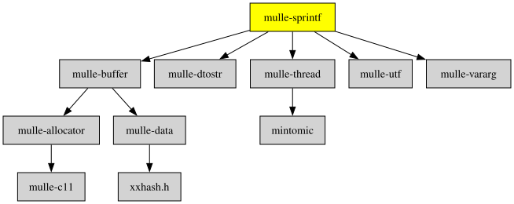

# mulle-sprintf

#### 🔢 An extensible sprintf function supporting stdarg and mulle-vararg

The extensibility is used in **MulleObjCStandardFoundation** to add object
conversion (%@) and to print BOOL values as 'YES', 'NO' (%bd).

Supports explicit UTF-32 (%S, %lS) and UTF-16 (%hS) output. No more `wchar_t`
pain.

mulle-sprintf can handle **varargs** and **mulle_vararg** style variable
arguments.

Floating point conversion is done by [mulle-dtostr](https://github.com/mulle-core/mulle-dtostr),
but fallback to C library FP can be used with `NO_MULLE__DTOSTR`.
`long double` arguments are cast to `double` before formatting.


| Release Version                                       | Release Notes  | AI Documentation
|-------------------------------------------------------|----------------|---------------
|  [](//github.com/mulle-core/mulle-sprintf/actions) | [RELEASENOTES](RELEASENOTES.md) | [DeepWiki for mulle-sprintf](https://deepwiki.com/mulle-core/mulle-sprintf)


## API

| File                                  | Description
|-------------------------------------- | -------------------------------------
| [`mulle_sprintf`](dox/API_SPRINTF.md) | The various sprintf like functions

### Major stdlib-compatible functions

| Function | Description
|----------|------------
| `mulle_sprintf` | sprintf replacement
| `mulle_snprintf` | snprintf replacement
| `mulle_asprintf` | asprintf replacement
| `mulle_buffer_sprintf` | sprintf into mulle_buffer
| `mulle_allocator_asprintf` | asprintf with custom allocator

### Format characters

For more detailed information on each characte consult a
[sprintf man page](https://manpages.org/sprintf).

### Flag Characters

| Character | Description
|-----------|---------------
| <tt>&nbsp;</tt> (SPC) | A blank should be left before a positive number.
| `0`       | The value should be zero padded.
| `#`       | The value should be converted to an "alternate form".
| `-`       | The converted value is to be left adjusted on the field boundary.
| `+`       | A sign  (+  or -) should always be placed before a number.
| `'`       | Use thousands' grouping characters (UNUSED)
| `b`       | BOOL, print as YES or NO (for Objective-C)

### Length modifier

| Characters | Description
|------------|---------------
| `h`        | `short` (or utf16)
| `hh`       | `char`  (or utf8)
| `j`        | `intmax_t`
| `l`        | `long`  (or utf32)
| `ll`       | `long long`
| `L`        | `long double` (FP only)
| `q`        | `int64.`
| `t`        | `ptrdiff_t`
| `z`        | `size_t`

### Conversion Specifiers (built in)

#### Integer

| Character | Description
|-----------|---------------
| `i`       | `int` as decimal
| `d`       | `int` as decimal
| `D`       | `long int`                   (compatibility)
| `u`       | `unsigned int`
| `o`       | `int` as octal
| `x`       | `int` as lowercase hex
| `U`       | `unsigned long int`          (compatibility)
| `O`       | `unsigned long int` as octal (compatibility)
| `X`       | `unsigned long int` as hex   (compatibility)

Used modifiers: all except `L`

#### Floating Point (FP)

Uppercase conversion specifiers output value such as 0e-20 or nan as
uppercase 0E-20 or NAN.

| Character | Description
|-----------|---------------
| `a`       | double as hex [-]0xh.hhhhp+-d
| `e`       | double as [-]d.ddde+-dd
| `f`       | double as [-]ddd.ddd  with lowercase for inf/nan
| `g`       | double in `e` or `f`
| `A`       | double as hex [-]0Xh.hhhhP+-d
| `E`       | double as [-]d.dddE+-dd
| `F`       | double as [-]d.ddde+-dd with uppercase for INF/NAN
| `G`       | double in `E` or `F`

Used modifiers: `L`.

The actual conversion is done with the C-library `sprintf` function. This is
contrast with the other conversions, which are not using the C library.
For portability across platforms `-nan` and `-0.0` will not be printed with the
leading minus sign.  

#### Pointer / String / Other

| Character | Description
|-----------|---------------
| `c`       | single character
| `C`       | wide character (utf16 with `h`, utf32 with `l` or no modifier)
| `n`       | return conversion
| `p`       | void * as hex with 0x prefix
| `s`       | char * as utf8 (alternate form `#s`: escaped for C String)
| `S`       | wide string (utf16 with `h`, utf32 with `l` or no modifier, utf8 with `hh`)

Used modifiers: `hl`

### Character and String Format Specifiers

mulle-sprintf provides two sets of character and string format specifiers:

#### Lowercase (C Standard Compatible - Platform Dependent)

These follow the C standard and use platform-dependent wide character types:

**%c - Character:**
- `%c`: `char` (single byte character)
- `%lc`: `wint_t` (wide character, platform-dependent encoding)

**%s - String:**
- `%s`: `char *` (null-terminated UTF-8/ASCII string)
- `%ls`: `wchar_t *` (wide string, platform-dependent encoding)
  - Windows: UTF-16 (wchar_t is 16-bit)
  - Linux/Unix: UTF-32 (wchar_t is 32-bit)

Use these when working with C standard library functions or platform APIs that expect `wchar_t`.

#### Uppercase (Explicit UTF Encoding - Platform Independent)

These provide explicit UTF encoding control, avoiding platform-dependent `wchar_t`:

**%C - Wide Character:**
- `%C` or `%lC`: `uint32_t` (UTF-32 codepoint, explicit 32-bit)
- `%hC`: `uint16_t` (UTF-16 code unit, explicit 16-bit)

**%S - Wide String:**
- `%S` or `%lS`: `uint32_t *` (UTF-32 string, explicit 32-bit per character)
- `%hS`: `uint16_t *` (UTF-16 string, explicit 16-bit per character)
- `%hhS`: `char *` (UTF-8 string, same as `%s`)

Use these when you need guaranteed UTF encoding regardless of platform.

**Key Differences:**

| Format | Type | Encoding | Platform Dependent? |
|--------|------|----------|---------------------|
| `%ls` | `wchar_t *` | UTF-16 (Windows) / UTF-32 (Unix) | Yes |
| `%lS` | `uint32_t *` | UTF-32 always | No |
| `%lc` | `wint_t` | UTF-16 (Windows) / UTF-32 (Unix) | Yes |
| `%lC` | `uint32_t` | UTF-32 always | No |

**Example:**

```c
// Platform-dependent (C standard)
wchar_t *wstr = L"Hello";
mulle_sprintf(buf, "%ls", wstr);  // Uses wchar_t encoding

// Platform-independent (explicit UTF-32)
uint32_t utf32_str[] = {'H', 'e', 'l', 'l', 'o', 0};
mulle_sprintf(buf, "%lS", utf32_str);  // Always UTF-32
mulle_sprintf(buf, "%S", utf32_str);   // Same as %lS
```


## Documentation & Guides

* [API Summary](asset/dox/api/toc)

## Usage

mulle-sprintf provides stdlib-compatible functions that work out of the box:

```c
char buf[ 32];

mulle_snprintf( buf, sizeof( buf), "%d", 1848);
```

```c
char *str;

mulle_asprintf( &str, "%s %d", "VfL", 1848);
mulle_free( str);
```

```c
mulle_buffer_do( buffer)
{
    mulle_buffer_sprintf( buffer, "%d", 1848);
}
```


### You are here




## Add

mulle-sprintf is a component of the [mulle-core](//github.com/mulle-core/mulle-core) library. So in your code include the mulle-core umbrella header:

``` c
#include <mulle-core/mulle-core.h>
```

### Add mulle-core to a cmake and git project

``` bash
git submodule add https://github.com/mulle-core/mulle-core.git mulle-core
```

Add this to your `CMakeLists.txt`:

``` cmake
add_subdirectory( mulle-core)
target_link_libraries( ${PROJECT_NAME} PRIVATE mulle-core)
```


### Add mulle-core to a mulle-sde project

``` sh
mulle-sde add github:mulle-core/mulle-core
```

### Embed mulle-sprintf with clib

``` sh
clib install --out src mulle-core/mulle-sprintf
```

Append `src` to your include path (e.g. add `-isystem src`  to your `CFLAGS`)
and compile all the sources that were downloaded.

## Install

Use [mulle-sde](//github.com/mulle-sde) to build and install mulle-sprintf and all dependencies:

``` sh
mulle-sde install --prefix /usr/local \
   https://github.com/mulle-core/mulle-sprintf/archive/latest.tar.gz
```

### Legacy Installation

Install the requirements:

| Requirements                                 | Description
|----------------------------------------------|-----------------------
| [mulle-buffer](https://github.com/mulle-c/mulle-buffer)             | ↗️  A growable C char array and also a stream - on stack and heap
| [mulle-utf](https://github.com/mulle-c/mulle-utf)             | 🔤 UTF8-16-32 analysis and manipulation library
| [mulle-vararg](https://github.com/mulle-c/mulle-vararg)             | ⏪ Access variable arguments in struct layout fashion in C
| [mulle-thread](https://github.com/mulle-concurrent/mulle-thread)             | 🔠 Cross-platform thread/mutex/tss/atomic operations in C
| [mulle-dtostr](https://github.com/mulle-core/mulle-dtostr)             | 🧶 Double to string conversion

Download the latest [tar](https://github.com/mulle-core/mulle-sprintf/archive/refs/tags/latest.tar.gz) or [zip](https://github.com/mulle-core/mulle-sprintf/archive/refs/tags/latest.zip) archive and unpack it.

Install **mulle-sprintf** into `/usr/local` with [cmake](https://cmake.org):

``` sh
PREFIX_DIR="/usr/local"
cmake -B build                               \
      -DMULLE_SDK_PATH="${PREFIX_DIR}"       \
      -DCMAKE_INSTALL_PREFIX="${PREFIX_DIR}" \
      -DCMAKE_PREFIX_PATH="${PREFIX_DIR}"    \
      -DCMAKE_BUILD_TYPE=Release &&
cmake --build build --config Release &&
cmake --install build --config Release
```


## Author

[Nat!](https://mulle-kybernetik.com/weblog) for Mulle kybernetiK  


